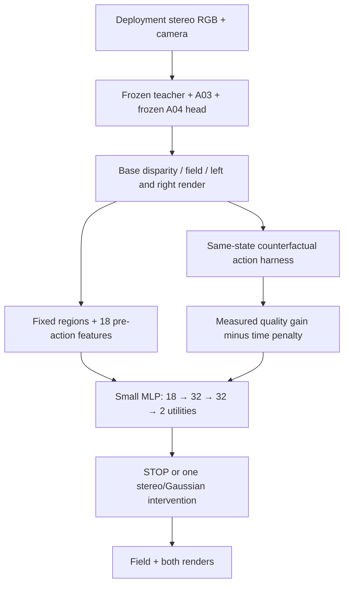

# Phase II action learning on a frozen A04 reference

## Scope and authority

The user explicitly approved this experimental schedule on 2026-10-05:

1. Freeze the current A04 reference and learn Phase II repair/action selection.
2. In a later implementation, add a student and jointly train the two phases.

This approval permits the isolated experiment despite the earlier gated
implementation order in Plans 09–13. It does **not** certify Gate I or Gate II,
erase historical negative intervention evidence, or establish calibrated
uncertainty. The current A04 artifact is a teacher-backed deterministic reference;
the selector does not invent `sigma_d`, `sigma_D` or center covariance.
The scientifically unmodified baseline and the A00–A04 path remain independent
of actions/routing. Student, KD, RL, and joint training are planned, not implemented
by this change.

## Actual executable architecture



The default selector has **1,730 parameters**. STOP utility is fixed to zero;
the two learned outputs are STEREO and GAUSSIAN gains. The two repair heads
have **3,176 parameters** together at width 32. Features contain RGB means,
pre-action left/right render residuals, disparity mean/std normalized by image
width, predicted/sensor support fraction, opacity, three metric scales and
region coordinates. They are detached and extracted before interventions.
There are no GT, action outcomes, post-repair residuals or oracle labels in
deployment feature inputs.

### Real actions

- **STOP:** exact borrowed base disparity, Gaussian field and renders; no new
  render or state mutation.
- **STEREO:** a pointwise `10 → 32 → 32 → 1` convolutional residual head reads
  RGB L/R, normalized disparity and the pre-action left render residual. Its
  correction is bounded by `min(4 pixels, 0.25 * positive effective disparity)`.
  Canonical A03 recomputes metric centers, surface frames and support from the
  repaired disparity; the frozen A04 head recomputes attributes. Correspondence
  must match the original `source_index`, or the action fails. The frozen
  reference head retains the base AMP policy so a
  zero stereo correction cannot obtain apparent gains by changing precision.
  Smoke checks zero-repair field/render agreement before any updates. This is a local
  residual head, not extra FoundationStereo recurrent iterations.
- **GAUSSIAN:** a `13 → 32 → 32 → 7` bounded residual MLP composes axis-angle,
  log-scale and opacity-logit corrections against the **actual A04 field**.
  Centers and disparity stay fixed. The canonical A04 composition owns rotation,
  scale, opacity and surface-covariance math. Center/effective uncertainty
  covariance inputs are explicitly unsupported in this deterministic extension.
  Its explicitly configured `composition_alpha_epsilon=1e-7` stabilizes logit
  composition around already learned FP32 opacity. Reusing the A04 prior's
  `1e-4` clamp would change learned opacities above `0.9999` even at zero repair;
  that is rejected by smoke identity checks. A04 bounds/formulas stay unchanged.

Fixed cores partition the output grid; halos include surface-neighbour reads.
`source_index` maps each core to primitive slots. Every out-of-core attribute
is copied exactly from the base. Stereo geometry is computed on the full grid
and merged into core slots; this deliberately freezes neighbour slots at patch
boundaries. The current implementation renders **both full frames** after each
repair. It does not claim patch-proportional execution, lower latency or a
multi-region/multi-round controller. Deployment chooses **at most one core/action
per frame**. The same `RepairActions.execute` serves learning, intervention
collection and selected inference.

## The guiding harness and learning schedule

This scientific harness is different from the logging/checkpoint harness.
Its environment is the frozen reference state, its actions are the actual
repairs, and its supervision is their measured outcome:

```text
Q = -mean(left Charbonnier RGB loss, right Charbonnier RGB loss)
gain(a) = Q(after a) - Q(base)
U(a) = gain(a) - cost_weight_per_ms * measured_action_ms
U(STOP) = 0
```

Left masks use deployment sensor support and predicted teacher validity;
right masks use sensor support. Both masks are fixed **before** intervention.
Post-action visibility never shrinks the loss denominator. Nonfinite renders
and empty observation masks fail explicitly. Local core losses are logged,
but the utility target uses global two-view loss, accounting for damage outside
the core. This new Phase II objective supervises **both views**; it does not
change the frozen A04 left-only training objective. RGB improvement is not proof
of metric GT geometry improvement.

Default training consists of:

1. One pass over unchanged `final_train` (dataset_1–7): train both repair heads
   against the same whole-frame base using differentiable two-view RGB loss.
   A04 and teacher have `requires_grad=False`, remain in eval mode and are absent
   from both Phase II optimizers.
2. Freeze the repair weights. One further pass over `final_train`: choose a
   rotating eligible core, execute STOP and the two repairs from the **same**
   base, synchronize CUDA timing, and train the selector by utility MSE.
   There is no action chaining or changing repair weights during label creation.

This temporary repair freeze makes first-stage labels stable. It is not a
restriction on the subsequently requested student/joint-training stage.
Oracle winners, full utility rows, features and sample provenance are retained
in the external JSONL log. Winning counts/heterogeneity and matched-cost final
quality still need evaluation; a learned dual-source selector is not evidence
that both repair types are useful.

### Allocation and timing limits

The allocator chooses a positive predicted utility/cost alternative within the
configured estimated action budget, otherwise STOP. A maximum observed cost per
action is retained as a conservative initial calibration. Costs include head,
geometry, full-frame composition/merge and both renders. Base inference is a
common cost, reported separately. Feature/selection and selected action times
are measured separately. Actual action overruns are explicitly reported;
estimated budgets are **not** hard runtime guarantees. Runtime measurements
depend on hardware contention and need a dedicated profiling experiment before
any efficiency claim. Counterfactual enumeration happens only while learning,
not in deployed selected inference.

## Data, identity and recovery

- Original SCARED only; training/smoke reject final_test. Dataset_8–9 remain
  final evaluation only. No roles/splits are changed or new validation split
  invented. Model selection needs an explicitly approved development protocol
  within dataset_1–7, before tuning against held-out sequences.
- A00 loads `include_supervision=False`; explicit GT supervision is rejected.
- Data roots, teacher assets, reference weights and generated logs/checkpoints
  are external. Supply paths via CLI/environment; no machine path is embedded
  in the implementation/configuration.
- The reference config is read from the **explicit A04 checkpoint** and loaded
  strictly, including teacher/renderer/config identity. No `latest` discovery
  or skipping compatibility checks.
- Phase II checkpoints contain only repair/selector weights, both optimizers,
  timing calibration, RNG and a committed sample cursor. They pin base SHA-256,
  role/manifest/config/source hashes, Git state and hardware/software identity.
- Periodic checkpoints are immutable and atomic; output directories must be
  new. SIGINT/TERM/HUP drain to a committed boundary. Known empty/near-clipped
  samples are logged/skipped, bounded by a consecutive skip limit. Unexplained
  failures stop. CUDA failure does not attempt to serialize poisoned state;
  resume the last already-written safe checkpoint into a new directory.
- `--max-steps` bounds consumed samples **across both stages**. A one-step
  training check exercises only repair warmup; `smoke` explicitly exercises
  repair learning, intervention collection, selector learning and selection
  on one sample. Smoke weights are diagnostic and are not a trained artifact.
- Resumed epochs are total configured epochs. RNG and cursor resume are exact;
  newly measured timing labels may vary with runtime contention, so bitwise
  reproducibility of future selector updates is not claimed.

## Commands

Run from the checkout. Set the following external paths to verified assets:

```bash
export PHASE2_PYTHON=<teacher-runtime-venv>/bin/python
export RELIABLE_ENDO_TEACHER_CONFIG=<teacher-runtime>/runtime.yaml
export RELIABLE_ENDO_TEACHER_SOURCE=<teacher-source-root>
export RELIABLE_ENDO_DATA_ROOT=<external-processed-SCARED-A00-root>
export A04_REFERENCE_CHECKPOINT=<explicit-frozen-A04-final.pt>
export PHASE2_RUN=<new-external-output-directory>
```

The standalone first-party CLI does not alter the existing A04 commands:

```bash
CUDA_VISIBLE_DEVICES=0 PYTHONPATH="$PWD/src:$RELIABLE_ENDO_TEACHER_SOURCE" "$PHASE2_PYTHON" \
  -m reliable_endo_gs.cli.phase2 smoke \
  --config configs/routing/frozen_a04.yaml \
  --data-root "$RELIABLE_ENDO_DATA_ROOT" \
  --manifest "$RELIABLE_ENDO_DATA_ROOT/a01_manifest.json" \
  --roles configs/teachers/a01_scared.yaml \
  --reference-checkpoint "$A04_REFERENCE_CHECKPOINT" \
  --sample-id dataset_1/keyframe_1/frame_data000000 \
  --output-dir "$PHASE2_RUN"
```

For the unchanged full training pool, replace `smoke` with `train` and omit
`--sample-id`. Optional `--max-steps N` bounds a run. To resume, additionally
pass `--checkpoint <explicit-Phase-II-stopped-or-periodic.pt>` and choose a
**new** output directory. The same source/config/upstream identities are required.
`infer --checkpoint <Phase-II-final.pt> --sample-id <explicit-ID>` executes only
selected inference; `--data-role final_test` is allowed for final assessment,
never learning. Native rendering requires exactly one visible physical GPU,
mapped to logical `cuda:0`. GPU 0 is the current available device; GPU 1 is not
part of this implementation validation.

## Validation and outstanding research

Focused tests exercise actual canonical A03/A04 composition with a differentiable
CPU analytic renderer: core correspondence, untouched centers for Gaussian
repair, both repair gradients, base immutability, fixed masks, exact STOP,
no GT loading, utility, allocator, frozen label weights, checkpoint identities,
RNG/cursor resume and failure recovery. They do not establish native GPU parity
or useful learned action selection. Real bounded GPU results are recorded in
external run artifacts; see the implementation completion report.

Not completed by this change: full repair/selector training, intervention utility
heterogeneity analysis, learned uncertainty integration, a development/model
selection split, comprehensive final GT/benchmark assessment, multi-action
allocation, student/KD and joint training. Preserve the current A04 artifact
as the control for those comparisons.
